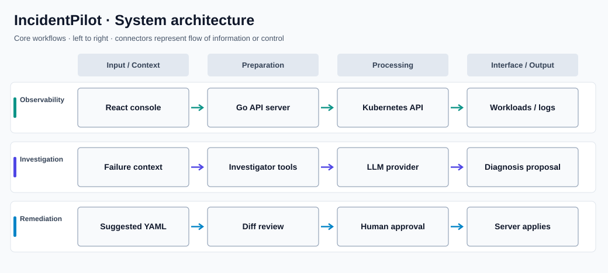

# IncidentPilot

**AI-assisted Kubernetes operations with human-controlled remediation**

## Overview

IncidentPilot is a local-first Kubernetes operations console built around a Go backend, a React interface, and an AI investigation service. Operators can inspect cluster workloads, events, logs, and metrics, then use model-assisted analysis to understand failures while retaining explicit control over proposed changes.

### Why this project matters

Operational tooling must make problems easier to diagnose without allowing automated assistants to mutate infrastructure without oversight. IncidentPilot separates read-only investigation from server-side, human-approved remediation.

## Key capabilities

- Provides Kubernetes resource, event, log, and operational health views.
- Displays Prometheus-backed metrics alongside application and cluster context.
- Uses structured investigation tools to give an AI agent constrained access to diagnostic evidence.
- Supports read-only operation and an assisted mode for proposed remediation.
- Shows the exact YAML change for operator review before approval.
- Keeps the investigation agent read-only and applies approved changes through the authorized server path.
- Provides development and demo workflows for a private test cluster.

## System architecture



The diagram organizes the major flows into aligned lanes to make their responsibilities and handoffs clear. It is a high-level view; individual modules may also communicate across lanes.

### How it works

The React console requests cluster information through the Go server. The investigation agent gathers diagnostic context through constrained tooling and consults an LLM provider when enabled. A suggested remediation is represented as a proposal rather than an automatic action.

The review path deliberately passes through a human decision. Only an approved proposal reaches the server-side Kubernetes mutation boundary.

## Technology stack

| Technology | Purpose |
| --- | --- |
| **Go** | Backend services and agent orchestration |
| **React / TypeScript** | Operator dashboard |
| **Kubernetes / Helm** | Cluster integration and deployments |
| **Prometheus** | Infrastructure and workload metrics |
| **Ollama / model providers** | Model-assisted investigation |
| **Docker** | Container builds and local environments |

## Repository structure

```text
cmd/             Go server and investigator entry points
internal/        Backend and orchestration packages
web/             React operator console
charts/          Helm deployment resources
deploy/          Kubernetes, Docker, and demo manifests
docs/            Architecture and operational guidance
Makefile         Development, deployment, and demo commands
```

## Getting started

```bash
cd web && npm install && cd ..
make dev
# Use an explicitly authorized, disposable Kubernetes cluster.
# Keep access private; begin in read-only mode.
```

## Notes and prerequisites

Review `docs/architecture.md`, `docs/security.md`, and deployment documentation before connecting a cluster. The repository provides demo tooling; the project should not be represented as an autonomous production remediation service.
