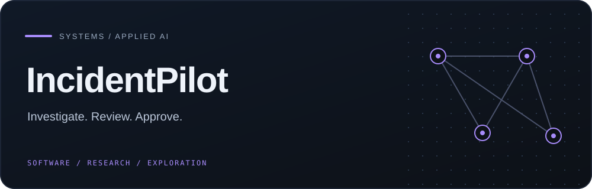
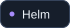
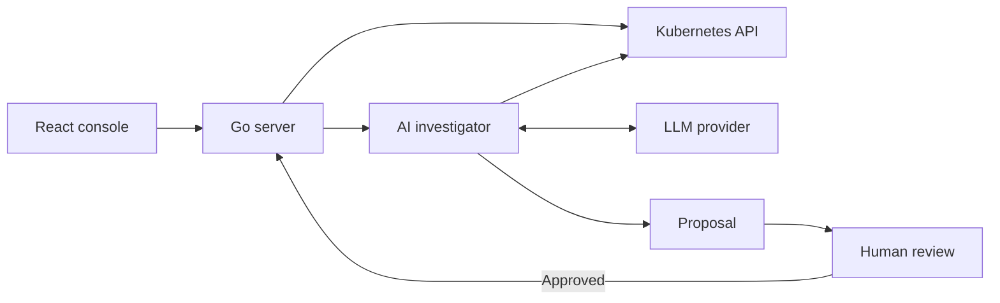

     

<strong>A local-first Kubernetes operations console with an AI investigator and human-reviewed remediation proposals.</strong>

## Overview

A local-first Kubernetes operations console with an AI investigator and human-reviewed remediation proposals.

### Why it matters

IncidentPilot brings events, logs, workload state, metrics, and model-assisted reasoning into one operator workflow without hiding the approval boundary.

## Key features

- Cluster resource, event, log, and terminal views
- Structured investigation tools for local or cloud LLMs
- Readonly and assisted operating modes
- Reviewable YAML remediation proposals

## Architecture

## Technology stack

**go** · **react** · **typescript** · **kubernetes** · **helm** · **prometheus**

## Getting started

Build the web app with Node.js 22+, then compile the Go server and investigator. Connect only to a disposable or explicitly authorized cluster, begin in readonly mode, and keep the console private.
