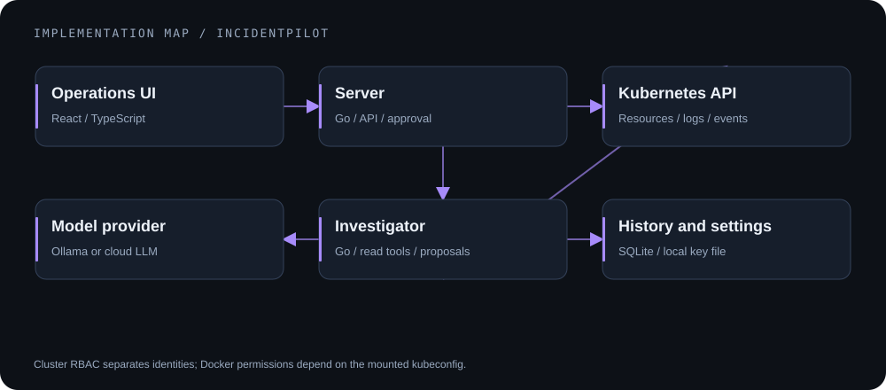
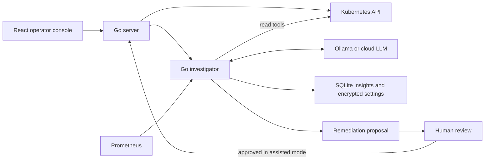
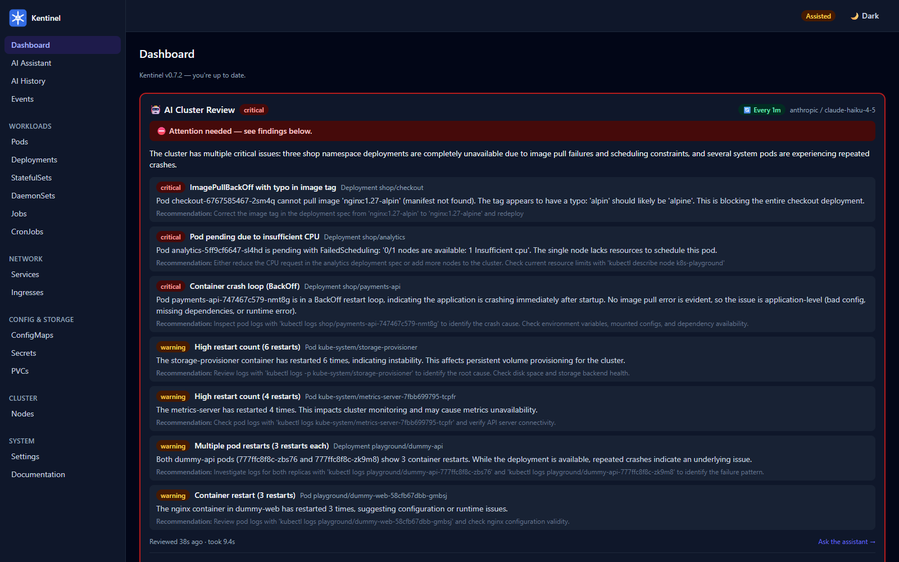
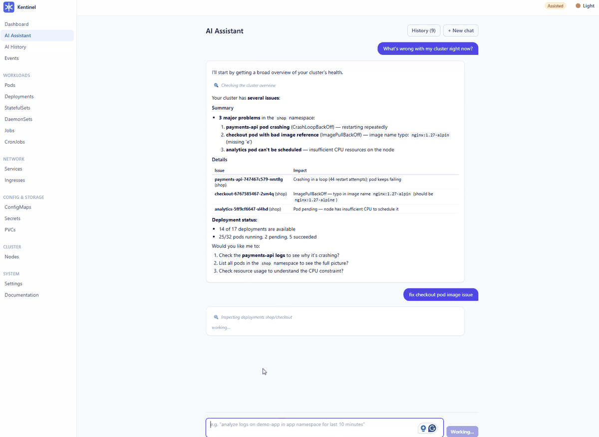

# IncidentPilot

     

**A local-first Kubernetes operations console with an AI investigator and human-reviewed remediation proposals.**

[Architecture](#architecture) · [Local setup](#local-setup) · [Security model](docs/security.md) · [Documentation](#documentation)

## From symptoms to a reviewable change

Cluster events, logs, workload state, and metrics often need to be read together to explain a failure. IncidentPilot brings those signals into one console. Its investigator can use read tools, explain findings, and propose a targeted YAML change; an operator reviews the proposal before the server applies it in assisted mode.

The project combines **Go services**, a **React/TypeScript UI**, Kubernetes clients, local history, and configurable LLM providers. It is intended for private operator access, not an unauthenticated public dashboard.

## Implemented capabilities

- Resource browsing, workload summaries, events, log streaming, and an assisted-mode pod terminal.
- Periodic AI reviews and an interactive investigation loop with structured tool calls.
- Persisted insights, usage information, notifications, and encrypted provider settings.
- Readonly and assisted modes, proposal review, and explicit server-side application.
- Docker, raw Kubernetes manifests, and Helm deployment configuration.

## Architecture



*Architecture illustration. Deployment permissions depend on the selected mode and credentials.*



## A deliberate permissions boundary

In the cluster deployment, the investigator has a read-only ServiceAccount. The server's allowed operations depend on readonly/assisted mode. Splitting the services keeps model/tool reasoning separate from the component that can apply changes.

Docker mode mounts a host kubeconfig: a read-only file mount does **not** make its Kubernetes credentials read-only. Use appropriately restricted credentials. There is no application authentication; keep services on localhost/private port-forward access. See the [security model](docs/security.md).

Assisted mode also exposes a manual YAML editor and terminal. Proposal approval describes the AI-remediation path, not a separate approval requirement for every human action.

## Existing demonstration



*Historical prototype screenshot with earlier UI branding; not evidence of a currently running public deployment.*

<details>
<summary>View the existing investigation and approval recording</summary>



</details>

## Local setup

Prerequisites: the Go toolchain declared in [go.mod](go.mod), Node.js 22+, npm, and a **disposable or explicitly authorized** Kubernetes environment for interactive operation. Ollama is the default local provider; cloud providers require their own authorized credentials.

```bash
cd web
npm ci
npm run build
cd ..
go build ./cmd/server ./cmd/agent
```

For Docker or Helm setup, follow [deployment documentation](docs/deployment.md). Review its cluster-changing commands before running them. Keep readonly mode for initial exploration.

## Verification

At audited source commit `ee332cc`, **93 top-level Go tests passed** and `go vet ./...` passed. One live Kubernetes exec test was skipped. Tests exercise fake cluster clients and local mock providers; they do not establish behavior against your cluster or a real LLM service.

```bash
go test ./...
go vet ./...
```

The audited frontend/docs builds were blocked by a missing `docs/security.md`. This documentation change supplies that referenced file. A successful current build must be confirmed by build output or CI rather than assumed from that repair.

## Engineering notes

| Design choice | Why it matters |
|---|---|
| Separate server and investigator | Independent responsibilities and cluster privilege boundaries |
| Provider interface | Supports local/cloud model adapters without coupling the investigator to one API |
| Reviewed YAML proposals | Operators inspect the proposed change rather than accepting an opaque action |
| Local persistence | Insight/settings state can survive restarts when the configured volume is retained |

## Documentation

[Architecture](docs/architecture.md) · [Deployment](docs/deployment.md) · [Configuration](docs/configuration.md) · [AI investigator](docs/ai-agent.md) · [API](docs/api.md) · [Security](docs/security.md) · [Apache-2.0 license](LICENSE)
